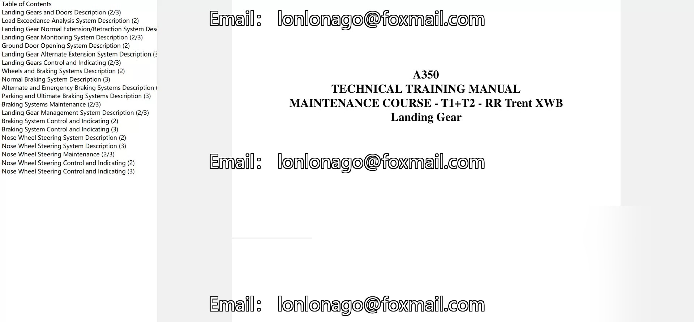
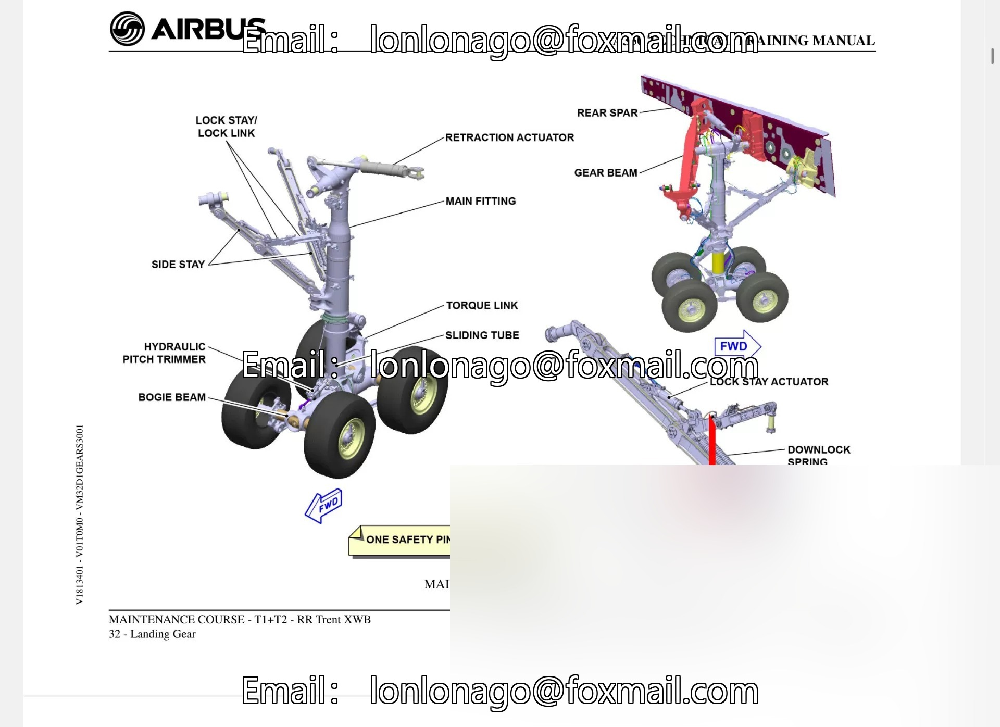
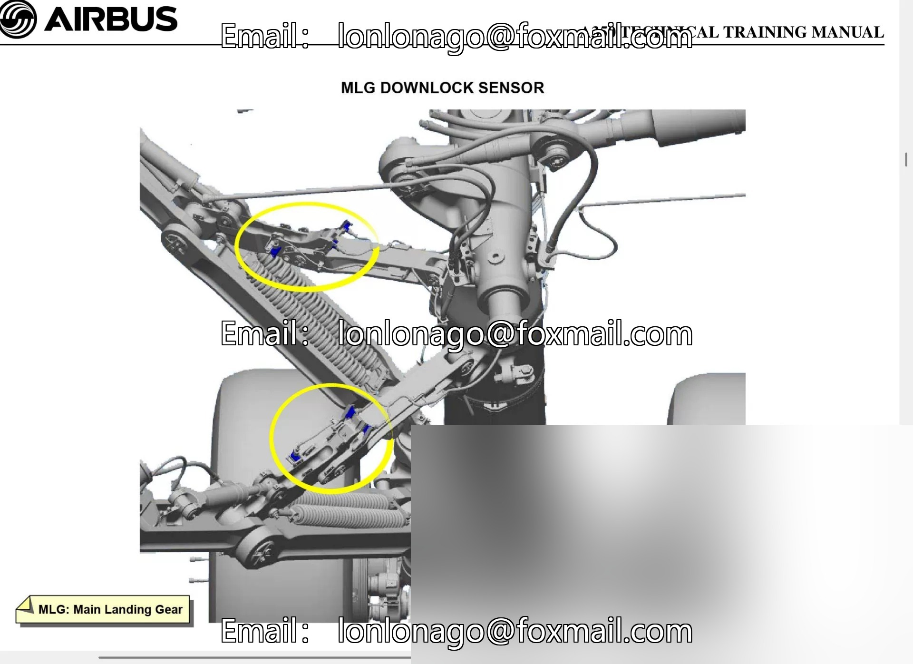

# A350 aircraft landing gear system technical training manual

## Body

A350 aircraft landing gear system technical training manual
Approximately 200 pages
1. Analysis of the documentation system
1. Landing gear and door system descriptions
2. System for normal extension/positioning of landing gear
3. System for normal opening/closing of landing gear on the ground
4. System for backup extension of landing gear
5. Tire and braking system
6. Braking system maintenance
7. Normal braking system
8. Remote control and emergency braking system
9. Stall braking system
10. Landing gear, door, tire, and braking system maintenance

2. Content characteristics
- Systematic introduction of A350 landing gear structure, working principles, and maintenance procedures
- Including detailed breakdown diagrams of MLG (Main Landing Gear), sensor locations, safe pins, and lock-down sensors, among other key parts
- Suitable for aviation maintenance, technical training, and professional study and use

3. Material attributes
- PDF format, , shipped via cloud storage
- Not returned, not exchanged

4. Specification of the condition
not physical books, the content is complete, the preservation is good

The manual covers A350 landing gear systems, maintenance procedures, MLG breakdowns and sensor information, with systematic introduction and training purposes.

<!-- AI_ENRICHED -->

## Images

## Payment

Here is a pay link on Stripe ( https://buy.stripe.com/3cs8yP7sY87d0vu9AB ). Please contact me lonlonago@foxmail.com after funding $89, and I will send you a complete data files , thank you!

